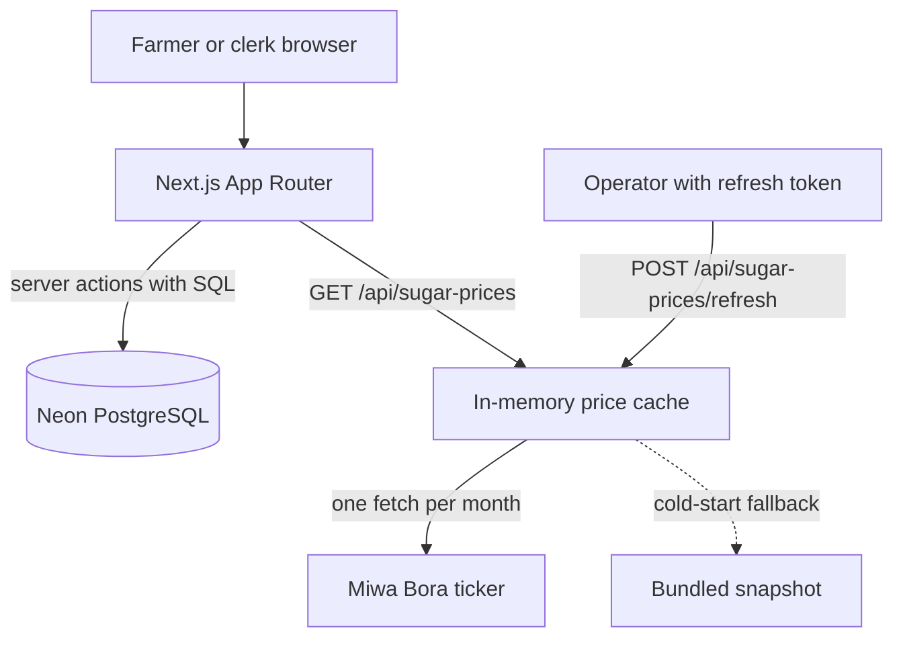
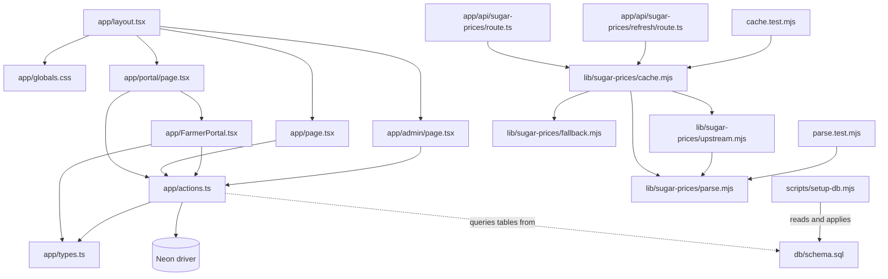
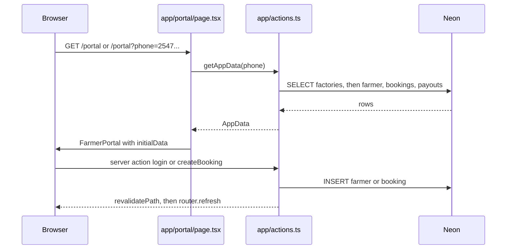
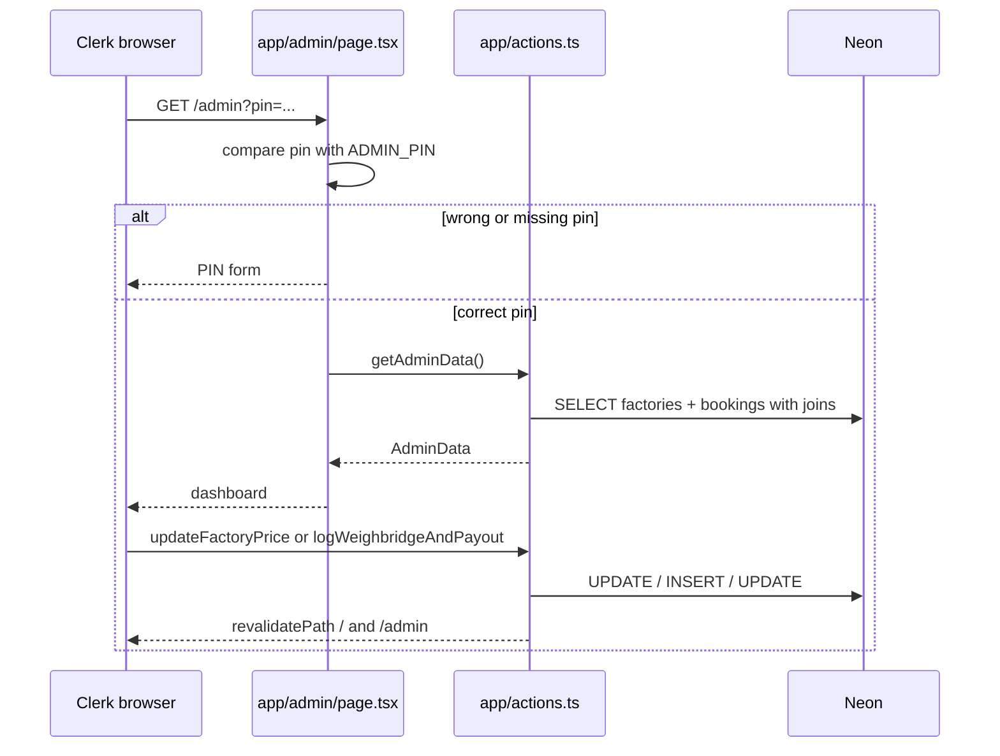
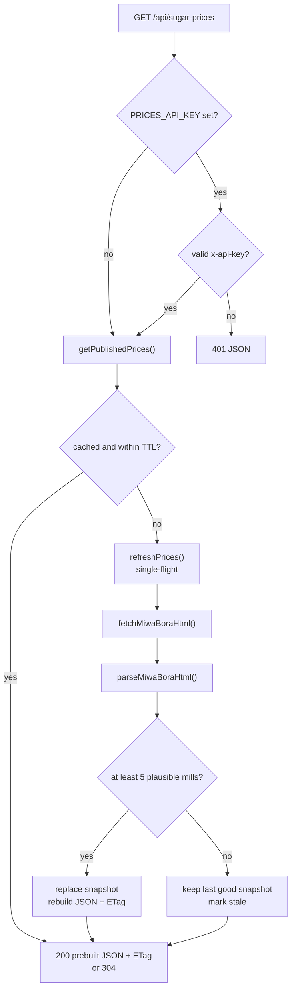
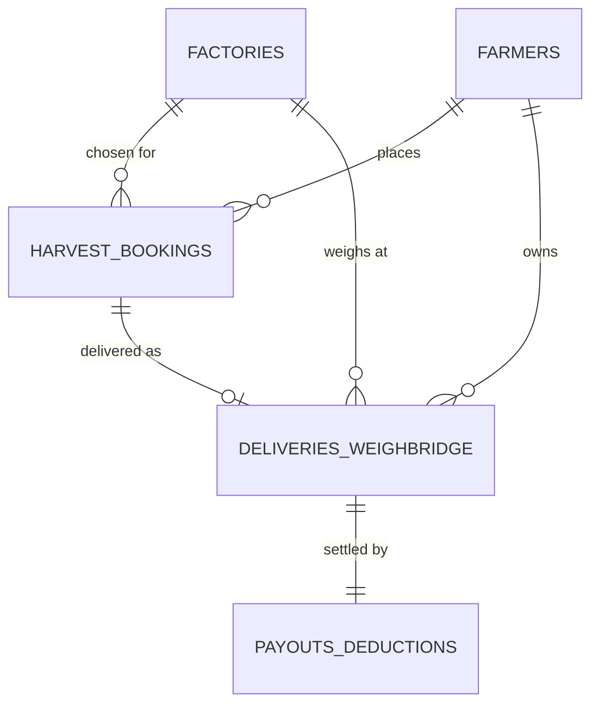

# MiwaConnect Kenya — Project Structure

This document maps every file in the repository, what it does, and how it
connects to the rest. Read it before changing code; the diagrams are kept small
on purpose so they render cleanly on GitHub, VS Code and mermaid.live.

- [1. What the app is](#1-what-the-app-is)
- [2. Technology and constraints](#2-technology-and-constraints)
- [3. Directory tree](#3-directory-tree)
- [4. System overview](#4-system-overview)
- [5. How the files connect](#5-how-the-files-connect)
- [6. Request flows](#6-request-flows)
- [7. Data model](#7-data-model)
- [8. Price API internals](#8-price-api-internals)
- [9. Configuration](#9-configuration)
- [10. Commands](#10-commands)
- [11. Conventions and gotchas](#11-conventions-and-gotchas)
- [12. Where to change what](#12-where-to-change-what)

---

## 1. What the app is

MiwaConnect Kenya has **two independent halves** that share a deployment but no
code path:

| Half | What it does | Storage |
| --- | --- | --- |
| **Landing page** (`/`) | Public overview: hero, live gate-price grid, how it works, payout explainer, FAQ and calls to action. | Reads `factories` for the grid only |
| **Farm platform** (`/portal`, `/admin`) | Farmers compare factory gate prices, register, book factory trucks, and see weighbridge deductions. Clerks update prices and record tickets. | Neon PostgreSQL |
| **Sugar price API** (`/api/sugar-prices`) | Serves the Kenya Sugar Board (Miwa Bora) ex-factory price ticker as JSON, polled upstream once a month. | In-memory cache only |

The two halves are intentionally **not wired together**: the KSB ticker quotes
sugar in **KES per 50 kg bag**, while `factories.price_per_tonne_kes` is the
**cane price in KES per tonne**. Mixing them would produce wrong payouts, so the
API never reads or writes the database.

---

## 2. Technology and constraints

- **Next.js 16.4.6** App Router, React 19, TypeScript (strict).
- **Tailwind CSS 4** via `@tailwindcss/turbopack` (no `tailwind.config` file).
- **Neon serverless Postgres** over HTTP (`@neondatabase/serverless`), no ORM.
- **Cache Components + Partial Prefetching** are enabled in `next.config.ts`.
  That is why the API routes call `await connection()` instead of exporting
  `dynamic = 'force-dynamic'` (the latter is rejected in this mode).
- Price modules are plain **`.mjs`** so they can be unit-tested with
  `node --test` without a bundler; TypeScript consumes them through JSDoc
  typedefs and `allowJs`.
- No test framework beyond Node's built-in runner. No state library, no UI kit.

---

## 3. Directory tree

```text
miwaconnect/
├─ app/
│  ├─ layout.tsx                 # root HTML shell, fonts, metadata
│  ├─ globals.css                # Tailwind import + theme tokens
│  ├─ page.tsx                   # "/" public landing page, live gate prices
│  ├─ portal/
│  │  └─ page.tsx                # "/portal" farmer page, loads AppData
│  ├─ FarmerPortal.tsx           # client UI: login, prices, bookings, payouts
│  ├─ actions.ts                 # all server actions + SQL
│  ├─ types.ts                   # shared row/response types
│  ├─ favicon.ico
│  ├─ admin/
│  │  └─ page.tsx                # "/admin" PIN gate + clerk dashboard
│  └─ api/
│     └─ sugar-prices/
│        ├─ route.ts             # GET  /api/sugar-prices
│        └─ refresh/
│           └─ route.ts          # POST /api/sugar-prices/refresh
├─ db/
│  └─ schema.sql                 # tables, sequences, generated columns, seed
├─ scripts/
│  └─ setup-db.mjs               # applies schema.sql to Neon
├─ lib/
│  └─ sugar-prices/
│     ├─ parse.mjs               # HTML → { observedAt, mills }
│     ├─ upstream.mjs            # guarded fetch of miwabora.go.ke
│     ├─ fallback.mjs            # bundled last-resort snapshot
│     ├─ cache.mjs               # state machine, polling, JSON+ETag build
│     ├─ parse.test.mjs          # parser tests (node --test)
│     └─ cache.test.mjs          # cache tests with fake fetch
├─ docs/
│  ├─ PROJECT_STRUCTURE.md       # this file
│  ├─ SugarPricesAPI.md          # public API contract
│  └─ CPANEL_DEPLOYMENT.md       # cPanel/Passenger deployment runbook
├─ public/                       # unused create-next-app SVGs
├─ next.config.ts                # cacheComponents, partialPrefetching, Tailwind
├─ server.js                     # cPanel Passenger entry point (CommonJS)
├─ tsconfig.json                 # strict, "@/*" → repo root, allowJs
├─ eslint.config.mjs             # eslint-config-next
├─ package.json                  # scripts + deps
├─ package-lock.json
├─ AGENTS.md                     # Next.js agent rules (managed by next dev)
├─ README.md                     # create-next-app boilerplate
├─ next-env.d.ts                 # generated, gitignored
├─ tsconfig.tsbuildinfo          # generated, gitignored
├─ .env.local                    # secrets, gitignored (never commit)
└─ .gitignore
```

---

## 4. System overview



Three deployment facts follow from this picture:

1. **The DB is only touched by server actions.** No client component imports
   `@neondatabase/serverless`; the connection string never reaches the browser.
2. **The price API has no database dependency.** Restarting the app loses the
   cache but not the source of truth; the next request refetches.
3. **The cache is per process.** On serverless, each instance warms itself; on a
   VPS/Docker, the background poller keeps one instance warm for a month.

---

## 5. How the files connect



Read the arrows as **"imports / calls"**. Nothing points from the farm platform
into the price API or vice versa — that separation is deliberate.

### File-by-file reference

#### App shell and UI

| File | Role | Connects to |
| --- | --- | --- |
| `app/layout.tsx` | Root layout: loads Geist fonts as CSS variables, sets `<title>`/description, renders `children` inside `<body>`. `LayoutProps<"/">` is a Next 16 generated type. | Imports `globals.css`; wraps every page including `/admin` and API routes (API responses bypass the layout at runtime). |
| `app/globals.css` | `@import "tailwindcss"`, defines `--background`/`--foreground`, maps font variables into Tailwind's `@theme inline`, plus a dark `prefers-color-scheme` block. | Imported only by `layout.tsx`; all utility classes in TSX depend on it. |
| `app/page.tsx` | Server component for `/`: the public landing page. Static hero, how-it-works, payout explainer, FAQ and CTA, plus a Suspense-wrapped live price grid fed by `getAppData()`. If the DB is unreachable the grid degrades to a link instead of failing the page. | Imports `getAppData` from `actions.ts`, `Factory` from `types.ts`, `Link`; links to `/portal` and `/admin`. |
| `app/portal/page.tsx` | Server component for `/portal`. Awaits `searchParams.phone`, calls `getAppData(phone)`, renders `<FarmerPortal initialData>`. Wrapped in `<Suspense>` because `searchParams` is async under Cache Components. Owns the portal metadata title. | Imports `getAppData` from `../actions`, `FarmerPortal`; the only entry point to the logged-in farmer UI. |
| `app/FarmerPortal.tsx` | `'use client'` UI. Three tabs — prices, bookings, payouts — distance-band selector, transport estimate, booking modal, login/auto-register form. Calls server actions and `router.push`/`router.refresh`. Brand links back to `/`. | Imports `registerOrLoginFarmer`, `createBooking` from `actions.ts`; types from `types.ts`; `Link` to `/` and `/admin`. Redirects to `/portal?phone=...` after login. Does not talk to Neon directly. |
| `app/admin/page.tsx` | Server component for `/admin`. Compares `?pin=` with `ADMIN_PIN` (fallback `2026`), renders a PIN form or the dashboard. Dashboard has per-factory price/queue forms and the weighbridge form. | Imports `getAdminData`, `updateFactoryPrice`, `logWeighbridgeAndPayout` from `../actions`; links back to `/`. Not wrapped in its own client component — forms post straight to server actions. |

#### Server layer

| File | Role | Connects to |
| --- | --- | --- |
| `app/actions.ts` | `'use server'`. The only module that runs SQL. Lazy `db()` avoids requiring `DATABASE_URL` at import/build time. Exports: `getAppData`, `registerOrLoginFarmer`, `createBooking`, `getAdminData`, `updateFactoryPrice`, `logWeighbridgeAndPayout`. Every mutation calls `revalidatePath('/')` and/or `/admin`. | Imports `neon` and `revalidatePath`; types from `types.ts`; queries tables created by `db/schema.sql`. Called by `page.tsx`, `FarmerPortal.tsx`, `admin/page.tsx`. |
| `app/types.ts` | Shared structural types for DB rows: `Factory`, `Farmer`, `HarvestBooking`, `AdminBooking`, `PayoutRow`, `AppData`, `AdminData`. Numeric columns are typed `string \| number` because Postgres `NUMERIC` arrives as a string over the Neon HTTP driver; UI code converts with `Number()`. | Imported by `actions.ts`, `FarmerPortal.tsx`. No runtime code. |

#### Database

| File | Role | Connects to |
| --- | --- | --- |
| `db/schema.sql` | Idempotent DDL: `factories`, `farmers`, `harvest_bookings`, `deliveries_weighbridge`, `payouts_deductions`; sequences for `F-0001`/`BK-0001`; generated columns for payable tonnage, gross and net pay; indexes; 10 seed factories with `ON CONFLICT DO NOTHING`. | Read by `scripts/setup-db.mjs`; its tables are queried by `actions.ts`. Never imported by app code. |
| `scripts/setup-db.mjs` | Loads `.env.local`, splits the schema on `;` (skipping comment-only chunks), executes each statement with `neon`, prints the count and factory total. Run once per database. | Imports `db/schema.sql` via `readFileSync`; uses `DATABASE_URL`. |

#### Price API

| File | Role | Connects to |
| --- | --- | --- |
| `app/api/sugar-prices/route.ts` | `GET`: optional `PRICES_API_KEY` check (constant-time), `mill`/`factory_id` filters, ETag/304, CORS, `X-Prices-Stale`/`X-Data-Origin` headers. Unfiltered requests return the prebuilt JSON string untouched. `OPTIONS` handles preflight. `await connection()` opts out of prerendering. | Imports `getPublishedPrices` from `cache.mjs`; no DB. Contract in `docs/SugarPricesAPI.md`. |
| `app/api/sugar-prices/refresh/route.ts` | `POST`: 503 when `PRICES_REFRESH_TOKEN` is unset, 401 on bad `x-refresh-token`/Bearer, otherwise `refreshPrices({ force: true })` and returns `updated`/`unchanged`/`notModified` or 502. `no-store`. | Imports `refreshPrices` from `cache.mjs`. Exists because the default poll is a month. |
| `lib/sugar-prices/parse.mjs` | Source constants (`SOURCE_ID`, `SOURCE_NAME`, `SOURCE_URL`, `PRICE_UNIT=KES per 50kg bag`), `PriceParseError`, `slugifyMill`, `htmlToText`, `parseMiwaBoraHtml`. Tag-agnostic: walks spans, falls back to `Name - 5700` text pairs, splits entries on `,(?=\s*[A-Za-z])`, validates the date. Throws instead of guessing. | No local imports. Used by `cache.mjs`, `upstream.mjs`, `parse.test.mjs`. |
| `lib/sugar-prices/upstream.mjs` | `MAX_BYTES = 2 MB`, `fetchMiwaBoraHtml`: fixed URL (no SSRF), 15 s timeout, User-Agent, accepts conditional headers, retries 5xx/429 up to 3 times with backoff, refuses non-HTML/oversized bodies, treats other 4xx as permanent. | Imports `SOURCE_URL` from `parse.mjs`; used by `cache.mjs`. |
| `lib/sugar-prices/fallback.mjs` | Frozen `BUNDLED_SNAPSHOT` of 15 mills observed 2026-11-23, with `origin: 'bundled-snapshot'`, `fetchedAt: null`, `contentHash: 'bundled-2026-11-23'`, and `factoryId` mappings for six mills. | Used only by `cache.mjs`, only when no live fetch has ever succeeded. |
| `lib/sugar-prices/cache.mjs` | The state machine. Holds `snapshot`, counters, last error, upstream validators, and `published` (prebuilt JSON + ETag). Exports `refreshPrices`, `getPublishedPrices`, `getSugarPrices`, `__resetPriceCacheForTests`. Configures TTL/interval/staleness, validates 3000–15000 KES and ≥5 unique mills, hashes canonical price sets, single-flights refreshes, and starts a chunked `setTimeout` poller on import (skipped during build and unref'd). | Imports `parse.mjs`, `upstream.mjs`, `fallback.mjs`; imported by both API routes and `cache.test.mjs`. |
| `lib/sugar-prices/parse.test.mjs` | 8 parser cases: live span markup, tag-stripped text, thousands separators/alternate dates, missing ticker, partial parse, impossible date, empty payload, slugify. | Imports `parse.mjs` directly; run by `npm run prices:test`. |
| `lib/sugar-prices/cache.test.mjs` | 8 cache cases: cold fetch, warm hit, single-flight, unchanged ticker, changed price, upstream failure keeps last good data, prebuilt JSON/ETag once per refresh, cold-start bundled fallback. Uses fake `Response`, counting fake fetch, `__resetPriceCacheForTests`. | Imports `cache.mjs`; run by `npm run prices:test`. |

#### Configuration, docs and generated files

| File | Role |
| --- | --- |
| `package.json` | Scripts (`dev`, `build`, `start`, `lint`, `db:setup`, `prices:test`) and the five runtime deps (`next`, `react`, `react-dom`, `@neondatabase/serverless`). |
| `next.config.ts` | Enables `cacheComponents`, `partialPrefetching`, and the Tailwind Turbopack rule for `*.css`. Changing cache config here affects how `page.tsx` and both routes behave. |
| `server.js` | CommonJS entry point for cPanel/Phusion Passenger. Loads the production build, fails fast with a clear log when `.next/BUILD_ID` is missing or the port is invalid, and listens on `process.env.PORT`. Not used by `npm run dev` or `npm start`. |
| `tsconfig.json` | Strict TS, `allowJs` (for `.mjs`), `@/*` → repo root, includes `.next/types`. `exclude: node_modules`. |
| `eslint.config.mjs` | Flat config extending `eslint-config-next`. `npm run lint` runs `eslint` with no path, which lints the project per this file. |
| `AGENTS.md` | Next.js-generated agent instructions; re-added by `next dev`. Not application code. |
| `README.md` | Unmodified create-next-app boilerplate; does not describe this project. |
| `docs/SugarPricesAPI.md` | Consumer-facing contract: endpoints, env vars, JSON schema, status codes, caching, tradeoffs. |
| `docs/PROJECT_STRUCTURE.md` | This architecture map. |
| `docs/CPANEL_DEPLOYMENT.md` | Step-by-step cPanel hosting runbook, requirements, environment variables and 503 troubleshooting. |
| `public/*.svg` + `app/favicon.ico` | Starter assets. The SVGs are unreferenced; `favicon.ico` is served automatically by the App Router. |
| `next-env.d.ts` | Generated by Next; gitignored. Do not edit. |
| `tsconfig.tsbuildinfo` | Incremental TS cache; gitignored. |
| `package-lock.json` | npm lockfile. |
| `.env.local` | Real secrets: `DATABASE_URL`, `ADMIN_PIN`. Gitignored; never read into source. |
| `.gitignore` | Ignores `node_modules`, `.next`, `.env*`, `*.tsbuildinfo`, `next-env.d.ts`. |

---

## 6. Request flows

### 6.1 Farmer page (`/portal`)



Notes:

- The landing page at `/` links here; `/portal` is the only page that loads a
  farmer session.
- With no `?phone`, only `factories` is fetched; `farmer` is `null` and the login
  form renders.
- Login is auto-register: `registerOrLoginFarmer` looks up the phone, returns the
  existing farmer, or inserts a new one (`F-0001`, …). On success the client
  navigates to `/portal?phone=...`, which re-runs `getAppData` on the server.
- Bookings are only visible to a logged-in farmer; the query joins
  `factories` purely to return `factory_name`.

### 6.2 Clerk dashboard (`/admin`)



`logWeighbridgeAndPayout` runs three statements in order: insert the weighbridge
row (the DB computes `payable_tonnage`), insert the payout row (the DB computes
`gross_kes` and `net_payout_kes`), then mark the booking delivered. There is no
explicit transaction, so a mid-sequence failure can leave a delivery without a
payout; retrying with the same ticket number fails on the primary key instead of
double-paying.

### 6.3 Price request (`/api/sugar-prices`)



Serverless detail: the TTL check happens **on the request**, so even without a
running timer a single request per month refreshes the data. On a long-lived
server the chunked poller does it in the background.

---

## 7. Data model



### Tables

| Table | Key | Important columns |
| --- | --- | --- |
| `factories` | `factory_id` (`FAC01`…) | `price_per_tonne_kes`, `avg_payment_days`, `payment_speed_rating`, `queue_status`, three transport-rate bands, `last_updated` |
| `farmers` | `farmer_id` auto `F-0001` | `full_name`, unique `phone_number`, `county_ward`, `plot_size_acres`, `contract_status` |
| `harvest_bookings` | `booking_id` auto `BK-0001` | FKs to farmer/factory, `est_tonnage`, `harvest_date`, `distance_band`, `need_cutters`, `status`, `factory_truck_plate` |
| `deliveries_weighbridge` | `ticket_no` | `gross_tonnes`, `tare_tonnes`, `trash_percent`, generated `payable_tonnage` |
| `payouts_deductions` | `payout_id` + unique `ticket_no` | `payable_tonnage`, price, four deductions, generated `gross_kes` and `net_payout_kes` |

### Money math lives in the database

```text
payable_tonnage = ROUND((gross_tonnes - tare_tonnes) * (1 - trash_percent/100), 3)
gross_kes       = ROUND(payable_tonnage * price_per_tonne_kes, 2)
net_payout_kes  = ROUND(gross_kes - transport - harvesting - input_loan - cess, 2)
```

Because these are `GENERATED ALWAYS … STORED`, the farmer's statement cannot
drift from the clerk's inputs. `app/actions.ts` never recomputes them; it reads
the stored values back.

---

## 8. Price API internals

`docs/SugarPricesAPI.md` is the public contract. This section explains the
implementation.

### Lifecycle

1. **Cold process, upstream reachable** — `getPublishedPrices()` has no
   `published` object, so it calls `refreshPrices()`. The fetch parses, validates,
   stores a snapshot, and `publish()` builds the payload, serialises it once, and
   stores a weak ETag derived from `data_version`.
2. **Warm process** — the prebuilt `json` and `etag` are returned; no upstream
   call, no re-serialisation, no DB.
3. **Warm but TTL expired** — if `now - lastChecked >= minRefresh`, a refresh is
   started. Concurrent callers share the same promise (single-flight).
4. **Unchanged ticker** — SHA-256 of the canonical `(slug, price)` set plus
   `observedAt` matches, so the snapshot is kept and `unchanged: true` is
   reported; the published body is rebuilt with fresh `last_checked_at`.
5. **Upstream failure** — the last good snapshot stays in place, `stale: true`
   and `stale_reason: "upstream_unavailable"`; the API keeps serving.
6. **Cold process, upstream down** — `BUNDLED_SNAPSHOT` is served with
   `data_origin: "bundled-snapshot"` and `stale: true`.
7. **Manual refresh** — `POST /api/sugar-prices/refresh` forces a check even
   inside the TTL, but still honours single-flight.

### Validation rules in `cache.mjs`

| Rule | Value | Why |
| --- | --- | --- |
| Price sanity | 3000–15000 KES per 50 kg | Reject layout changes that produce garbage |
| Unique mills | de-duplicate by slug | A repeated mill would double-count |
| Minimum mills | 5 | Refuse a partial ticker rather than publish it |
| Timestamp | ISO date from the ticker | Detects a stale page |
| Hash | `sha256` over sorted `(slug, price)` + date | Idempotency without upstream `ETag` |

### Timing defaults

| Setting | Default | Env var |
| --- | --- | --- |
| TTL | 30 days | `PRICES_TTL_SECONDS` |
| Minimum gap between checks | 60 s | `PRICES_MIN_REFRESH_SECONDS` |
| Background poll | 30 days | `PRICES_REFRESH_INTERVAL_SECONDS` |
| Stale flag after | 3 days | `PRICES_STALE_AFTER_DAYS` |
| CDN edge cache | `min(TTL, 1 h)` | — |

Timers longer than 2^31−1 ms are scheduled in chunks, because `setTimeout`
silently degrades to a 1 ms loop above that limit.

---

## 9. Configuration

`.env.local` (never committed):

| Variable | Used by | Effect |
| --- | --- | --- |
| `DATABASE_URL` | `actions.ts`, `setup-db.mjs` | Neon connection string. Missing → server actions throw a setup hint. |
| `ADMIN_PIN` | `admin/page.tsx` | Clerk PIN; falls back to `2026` when unset. |
| `PRICES_API_KEY` | `sugar-prices/route.ts` | Unset = public, CDN-cacheable. Set = `x-api-key`/Bearer required, `Cache-Control: private`. |
| `PRICES_REFRESH_TOKEN` | `refresh/route.ts` | Unset = manual refresh disabled (503). |
| `PRICES_TTL_SECONDS` | `cache.mjs` | Freshness window; clamped 60 s–31 days. |
| `PRICES_MIN_REFRESH_SECONDS` | `cache.mjs` | Anti-stampede floor; clamped 5 s–1 h. |
| `PRICES_REFRESH_INTERVAL_SECONDS` | `cache.mjs` | Background poll; clamped 60 s–31 days. |
| `PRICES_STALE_AFTER_DAYS` | `cache.mjs` | Age at which `stale` flips; clamped 1–365. |

---

## 10. Commands

| Command | What it does |
| --- | --- |
| `npm run dev` | Next dev server on :3000 (Turbopack). Also regenerates `AGENTS.md`. |
| `npm run build` | Production build + TypeScript check. |
| `npm start` | Serve the production build. |
| `npm run lint` | ESLint over the project. |
| `npm run db:setup` | Apply `db/schema.sql` to `DATABASE_URL` (idempotent). |
| `npm run prices:test` | 16 Node tests for parser and cache. |
| `npx tsc --noEmit` | Standalone typecheck (includes `.mjs` JSDoc). |
| `node server.js` | Production start used by cPanel/Passenger (requires `npm run build`). |

First-time setup:

```bash
cp .env.example .env.local   # if present; otherwise create it
# add DATABASE_URL=... and ADMIN_PIN=...
npm run db:setup
npm run dev
```

---

## 11. Conventions and gotchas

- **Server vs client boundary.** Only `FarmerPortal.tsx` is a client component.
  It receives plain JSON-serialisable data and calls server actions; it must
  never import `actions.ts` internals or the Neon driver.
- **`NUMERIC` returns strings.** Always `Number(...)` before arithmetic or
  `toLocaleString()`. `types.ts` encodes this (`string | number`).
- **Server actions and build time.** `db()` is lazy so `next build` does not need
  `DATABASE_URL`. Do not hoist `neon(process.env.DATABASE_URL)` to module scope.
- **`connection()`.** Under `cacheComponents`, route handlers that must run per
  request call `await connection()`; exporting `dynamic` is rejected.
- **Prices are not cane prices.** KSB quotes KES/50 kg bag; payouts use
  KES/tonne of cane. Keep the API read-only and separate.
- **Admin auth is a query-string PIN.** It is a clerk convenience, not real
  authentication; anyone with the URL can enter. Do not treat it as a security
  boundary.
- **In-memory cache is per instance.** Serverless cold starts refetch once;
  `data_origin` and `X-Data-Origin` tell you which path served the response.
- **`.mjs` files are typechecked through JSDoc.** Add `@typedef`/`@returns` when
  changing exported shapes, or `next build` will infer `null`/`any` and fail.
- **Staleness is honest.** With monthly polling, `stale` is `true` after day 3
  unless `PRICES_STALE_AFTER_DAYS` is raised or a manual refresh happens.
- **Generated files.** Never edit `next-env.d.ts` or `tsconfig.tsbuildinfo`; they
  are gitignored and rebuilt.

---

## 12. Where to change what

| Goal | Touch |
| --- | --- |
| Change the marketing landing page | `app/page.tsx` (keep the live grid honest; it reads the same `factories` table) |
| Change farmer page layout or tabs | `app/FarmerPortal.tsx` |
| Add a field to the farmer form | `FarmerPortal.tsx` form + `registerOrLoginFarmer` + `db/schema.sql` + `types.ts` |
| Change booking rules | `createBooking` in `app/actions.ts` (and possibly a DB constraint) |
| Add a factory column | `db/schema.sql`, `Factory` in `types.ts`, relevant query in `actions.ts`, UI |
| Change payout math | `db/schema.sql` generated columns only — never recompute in JS |
| Change admin dashboard | `app/admin/page.tsx`, actions in `app/actions.ts` |
| Change JSON shape or headers | `buildPayload` in `lib/sugar-prices/cache.mjs`, `route.ts`, `docs/SugarPricesAPI.md` |
| Change polling cadence | env vars, or `config()` in `cache.mjs` |
| Adapt to a new ticker layout | `parse.mjs` + a fixture case in `parse.test.mjs` |
| Add an upstream guard | `upstream.mjs` |
| Rotate the bundled fallback | `fallback.mjs` (update date and mill list together) |
